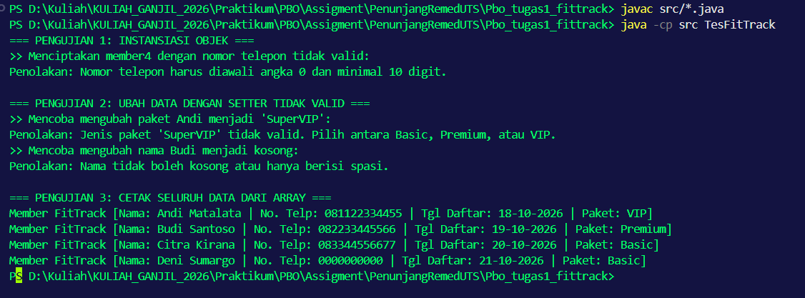

# Tugas 1: Sistem Keanggotaan Gym FitTrack

* **Nama Lengkap:** Najahal Khaira
* **NPM:** 250810701100040
* **Kelas:** Praktikum PBO A

## Deskripsi Singkat
Program Java ini merupakan purwarupa sistem pendataan member di gym FitTrack. Program ini bertugas mencatat dan memvalidasi data pendaftaran member (nama, nomor telepon, tanggal daftar, dan jenis paket) sebelum menyimpannya ke dalam memori aplikasi selama jam operasional.

## Fitur Utama
* Mendaftarkan data member baru beserta validasi input.
* Mencegah sistem menyimpan nama yang kosong atau berisi spasi saja.
* Mencegah penyimpanan nomor telepon yang tidak diawali angka 0 dan kurang dari 10 digit.
* Memberikan nilai paket default ("Basic") secara otomatis jika pengguna tidak memasukkan pilihan paket yang valid.
* Menampilkan daftar seluruh member gym dalam format teks yang rapi.

## Konsep OOP yang Diterapkan
| Nama Konsep | Lokasi Penerapan | Alasan Singkat |
|---|---|---|
| Encapsulation | Class `Member` (Atribut `private`, `getter`/`setter`) | Melindungi data dari pengubahan langsung tanpa validasi. Validasi terpusat pada setter. |
| Constructor Overloading | Class `Member` | Memberikan fleksibilitas instansiasi objek, baik dengan 3 parameter (tanpa paket) maupun 4 parameter lengkap. |
| Class & Object | `Member.java` dan `TesFitTrack.java` | Memisahkan cetak biru entitas member dengan kelas utama yang menguji skenario. |

## Struktur Project
```text
tugas1-fittrack/
├── src/
│   ├── Member.java
│   └── TesFitTrack.java
├── .gitignore
└── README.md
```

## Prasyarat
* JDK 17 atau lebih baru
* Terminal / PowerShell

## Cara Menjalankan Program
1. Buka terminal (PowerShell/Command Prompt) pada folder utama project.
2. Kompilasi kode dengan perintah: `javac src/*.java`
3. Jalankan program dengan perintah: `java -cp src TesFitTrack`

## Nilai Default
Jika terdapat nilai yang tidak valid saat `constructor` dipanggil, objek tetap dibentuk dengan nilai default yang aman agar program tidak berhenti paksa:
* Nama: "Member Tanpa Nama"
* Nomor Telepon: "0000000000"
* Tanggal Daftar: "01-01-2026"
* Paket: "Basic"

## Contoh Output Program
